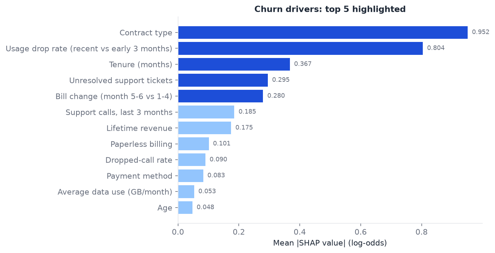
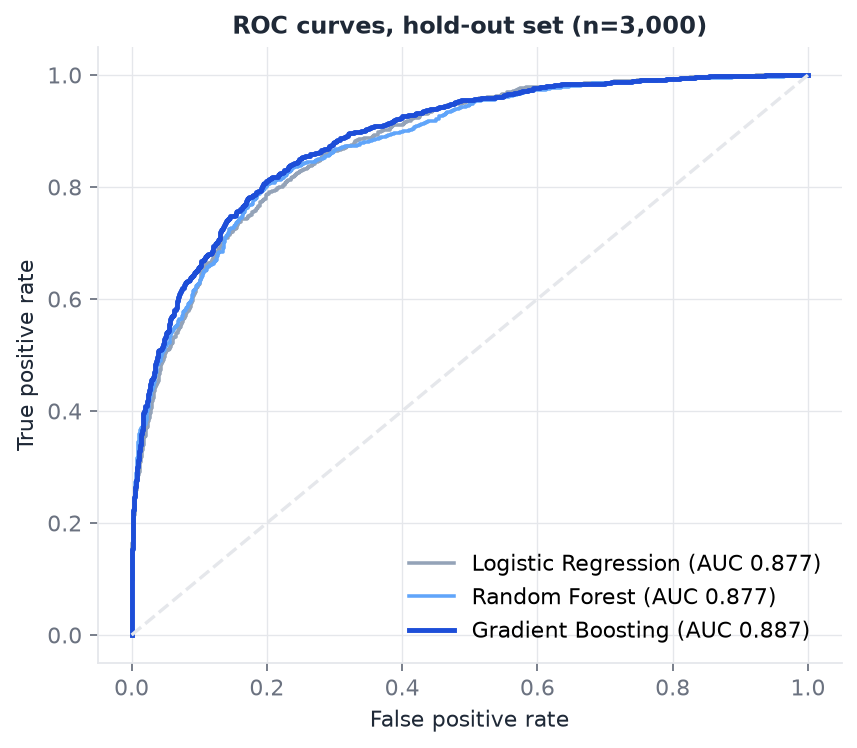
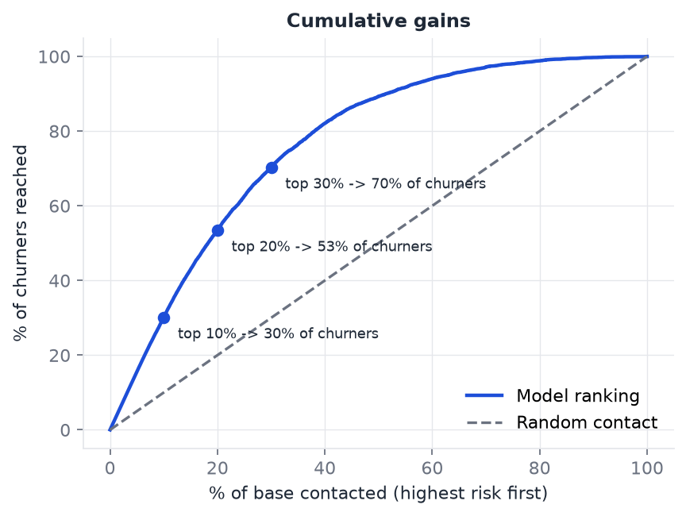
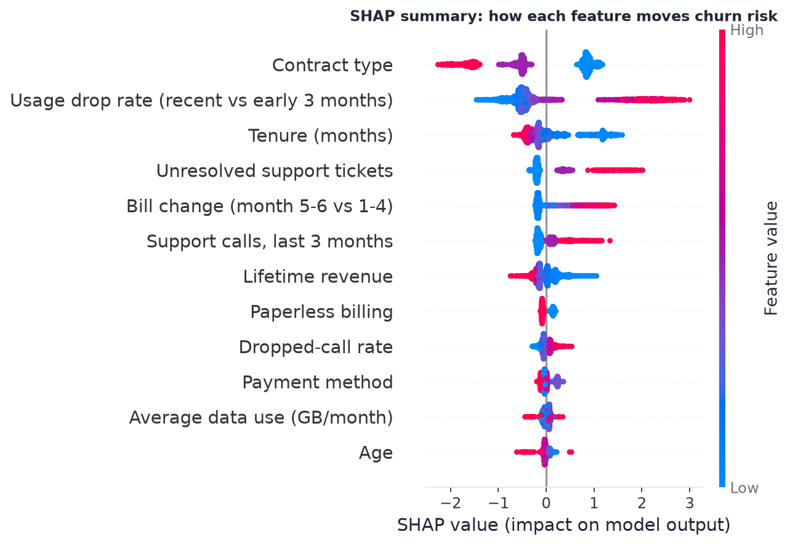
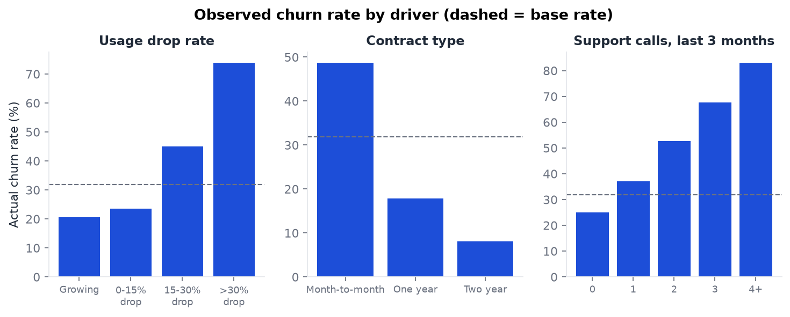
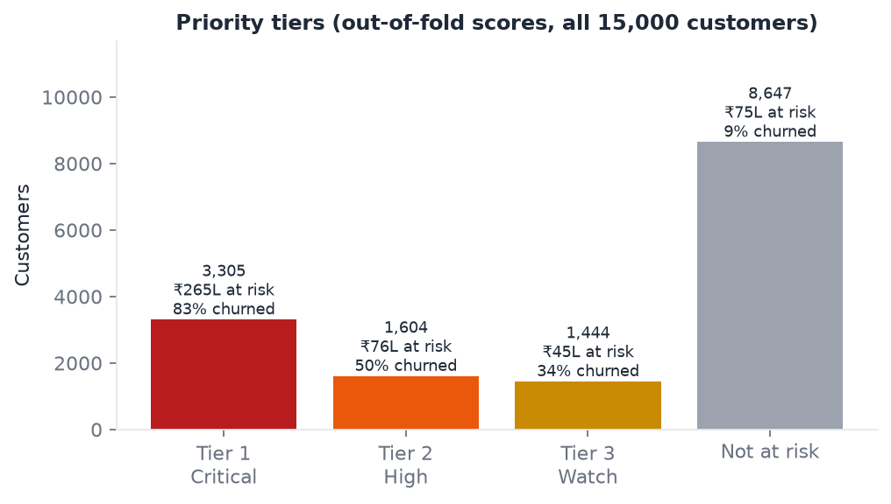
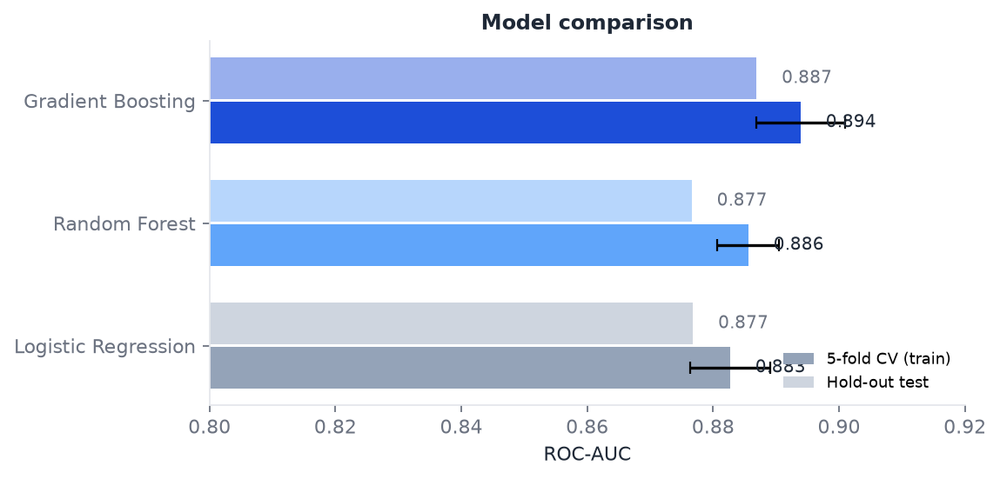

# Predictive Churn Analysis & Retention Modelling (Telecom)

Which subscribers are about to leave, why, and who should the retention team call first?
Built in Python (pandas, scikit-learn, SHAP, matplotlib, openpyxl) with the feature layer in **SQL (SQLite)**. The project turns three raw warehouse tables for 15,000 subscribers into 30 engineered features, trains and compares three classifiers, explains the best one with SHAP, and sorts the at-risk base into three action tiers with a retention ROI model.

**[Executive brief (PDF)](outputs/Churn_Executive_Brief.pdf)** · [Executive summary](outputs/executive_summary.md) · [Excel retention-ROI model](outputs/excel/Churn_Retention_Model.xlsx)



## Key findings

| | |
|---|---|
| Subscribers / churn rate | 15,000 / **31.9%** (₹462 L annualised revenue lost) |
| Features engineered in SQL | **30** (20+ behavioural: usage trend, support friction, billing, network) |
| Best model | **Gradient Boosting: 0.887 ROC-AUC on hold-out**, 0.894 in 5-fold CV |
| Reach of the top 20% by risk score | **53% of all churners** (random outreach: 20%) |
| At-risk customers in 3 priority tiers | **6,353**, carrying **₹386 L** of annual revenue at risk |
| Retention plan at default assumptions | ~1,060 customers saved, ₹102 L revenue retained for ₹32 L offer cost (2.2x net return) |

**Model comparison** (stratified 80/20 split; the hold-out set is used once, for the final numbers)

| Model | CV ROC-AUC | Test ROC-AUC | PR-AUC | Precision | Recall | F1 |
|---|---|---|---|---|---|---|
| Logistic Regression | 0.883 ± 0.006 | 0.877 | 0.791 | 0.649 | 0.779 | 0.708 |
| Random Forest | 0.886 ± 0.005 | 0.877 | 0.798 | 0.687 | 0.742 | 0.714 |
| **Gradient Boosting** | **0.894 ± 0.007** | **0.887** | **0.812** | 0.696 | 0.751 | **0.722** |

The classification threshold (0.36 for Gradient Boosting) maximises F1 on cross-validated training predictions, not on the test set.

**Top 5 churn drivers (mean |SHAP|, hold-out set)**

| # | Driver | Share of attribution | Effect | Observed churn |
|---|---|---|---|---|
| 1 | Contract type | 25% | Month-to-month highest risk, two-year lowest | 49% vs 8% |
| 2 | Usage drop rate (recent 3 vs early 3 months) | 21% | Higher drop → more churn | 74% when usage fell >30% |
| 3 | Tenure | 10% | Longer tenure → less churn | |
| 4 | Unresolved support tickets | 8% | More → more churn | 81% with 2+ unresolved |
| 5 | Bill change (months 5-6 vs 1-4) | 7% | Bill rise → more churn | 45% after a >5% rise |

**Priority tiers** (every customer scored out-of-fold, so no customer is scored by a model that saw their label)

| Tier | Rule | Customers | Predicted risk | Actual churn | Revenue at risk (₹ L/yr) | Action |
|---|---|---|---|---|---|---|
| Tier 1: Critical | p ≥ 0.60 | 3,305 | 83% | 83% | 264.9 | Retention-desk call within 7 days, ordered by revenue at risk |
| Tier 2: High | 0.40 ≤ p < 0.60 | 1,604 | 50% | 50% | 75.9 | Targeted contract-migration or bill-shock offer via app/SMS |
| Tier 3: Watch | 0.25 ≤ p < 0.40 | 1,444 | 32% | 34% | 45.1 | Automated nurture, monthly re-score, escalate on a new unresolved ticket |
| Not at risk | p < 0.25 | 8,647 | 9% | 9% | 75.2 | Business as usual |

Predicted and actual churn match closely in every tier, so the scores are well calibrated enough to size the campaign on.

**So what:**
- **Contract type is the biggest structural driver, and falling usage is the earliest behavioural warning.** A customer whose usage is sliding shows it months before they call to cancel, so an automated check-in at a 15% month-on-month drop catches them while there is still time.
- **Support friction is the most fixable driver.** Two unresolved tickets push churn to 81%. Routing the second unresolved ticket to a senior agent costs little and goes straight at a top-5 driver.
- **The month-5 price rise backfired** for Basic and Standard customers: 2,068 affected customers churn at 45% against a 32% base. Grandfathering Tier 1-2 customers on those plans is cheaper than replacing them.
- Every offer should run with a 10% randomised control group. SHAP explains the model, not the causal effect of an offer.

Full write-up: [`outputs/executive_summary.md`](outputs/executive_summary.md).




## Data: what's real vs synthetic
All data is **synthetic** (`src/data_generator.py`, seed 42), shaped like a telecom operator's warehouse extract:

| Table | Rows | Grain |
|---|---|---|
| `customers` | 15,000 | one row per subscriber: plan, contract, tenure, payment method, lines, add-ons |
| `usage_monthly` | 90,000 | 6 months of data, voice, SMS, bill, late days and dropped-call % per subscriber |
| `support_tickets` | ~16,000 | one row per contact: category, resolved flag, resolution hours, CSAT |

Churn is drawn from a hidden logistic process driven by behaviour (usage decline, support friction, contract, tenure, bill shock, payment method) with noise. The model never sees that formula. It gets only the raw tables and has to recover the signal through the SQL features. This is a methodology demonstration: point `pipeline.py` at a real extract with the same three tables and the SQL, models and reports run unchanged.

## Method
1. **Load and validate:** 11 data-quality checks (keys unique, 6 months per customer, no orphan tickets, value ranges), raw tables into SQLite, `pipeline_runs` audit row.
2. **Feature engineering in SQL** ([`sql/01_feature_engineering.sql`](sql/01_feature_engineering.sql)): CTEs and window functions (`LAG`) build one row per customer. It includes usage drop rate (recent 3 vs early 3 months, data + voice blended), months with falling usage, last month vs 6-month average, bill change %, late payments, dropped-call rate, support calls (6 months and recent), unresolved, billing and network tickets, resolution time, CSAT and lifetime revenue.
3. **Models:** Logistic Regression (scaled + one-hot), Random Forest (400 trees) and Gradient Boosting (300 trees, depth 3, subsample 0.8). They are compared on 5-fold stratified CV, and the hold-out set gives the final numbers.
4. **Explainability:** SHAP `TreeExplainer` on the Gradient Boosting model. Drivers are ranked by mean |SHAP|. Each customer gets their own top-3 reasons in the call list.
5. **Segmentation:** 5-fold out-of-fold probabilities for all 15,000 customers, then probability tiers. Customers are ranked within each tier by annual revenue at risk (p × monthly bill × 12). The tier summary is a SQL view ([`sql/02_tier_summary.sql`](sql/02_tier_summary.sql)).
6. **ROI model:** in Excel, edit contact rate, save rate and offer cost per tier, and the formulas recalculate customers saved, revenue retained and net return.

Full detail: [`docs/methodology.md`](docs/methodology.md).

## Run
```
python -m venv .venv && .venv\Scripts\activate
pip install -r requirements.txt
python src/run_all.py      # ~1-2 min: data -> SQL features -> 3 models -> SHAP -> tiers -> all outputs
```

| Output | What it is |
|---|---|
| `outputs/Churn_Executive_Brief.pdf` | Two-page brief: KPIs, model comparison, ROC, gains, drivers, tiers, recommendations |
| `outputs/executive_summary.md` | Executive summary with retention recommendations |
| `outputs/excel/Churn_Retention_Model.xlsx` | Retention ROI what-if (yellow inputs), tier summary, model comparison, drivers, Tier 1 call list |
| `outputs/customer_risk_scores.csv` | Every customer: churn probability, tier, revenue at risk, top-3 SHAP reasons, action |
| `outputs/model_comparison.csv`, `shap_driver_ranking.csv`, `tier_summary.csv`, `kpis.json` | Result tables |
| `outputs/churn.db` | Built locally on each run (not committed). SQLite: raw tables, `customer_features`, `churn_scores`, `tier_summary` view, `pipeline_runs` |
| `outputs/figures/*.png` | 7 charts |
| `outputs/data_quality_report.md` | Validation results |

## Charts


*Contract type is ordinal-encoded alphabetically for the tree model (Month-to-month = low/blue, Two year = high/red), so blue points on the right mean month-to-month raises risk.*





## Repository
```
sql/
  01_feature_engineering.sql   raw tables -> customer_features (CTEs, LAG window)
  02_tier_summary.sql          scored base -> tier_summary view
src/
  data_generator.py   synthetic customers / usage / tickets (seed 42)
  pipeline.py         validate -> SQLite -> run SQL features
  models.py           LR / RF / GB training, CV, hold-out metrics, out-of-fold scores
  explain.py          SHAP driver ranking and per-customer reasons
  segmentation.py     priority tiers, revenue at risk, playbook
  report.py           figures, Excel ROI model, executive summary, PDF brief
  run_all.py          one-command entry point
docs/methodology.md
outputs/
```

## Author
**Ishaan Mankotia** · [GitHub](https://github.com/Ishaan1000)

MIT License
